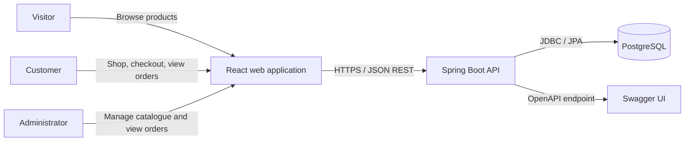
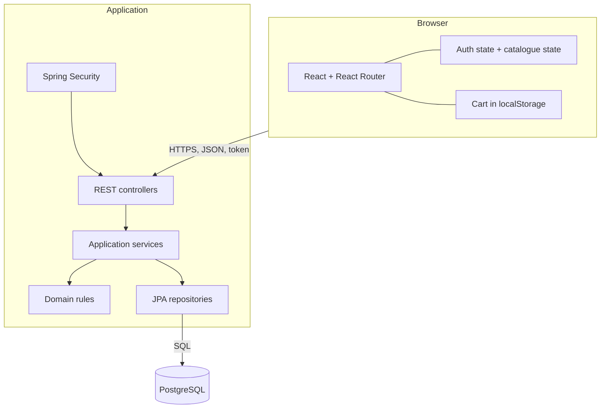
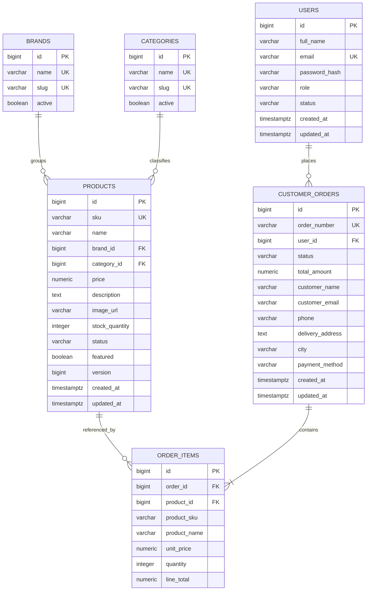

# Lumière Beauty — Solution Architecture Plan

**Project:** Flash Solution / Lumière Beauty cosmetics shop  
**Document status:** Proposed architecture for MVP implementation  
**Prepared:** 5 November 2026  
**Target delivery:** 13-day MVP  
**Primary audience:** Front-end developers, back-end developers, reviewers, and project stakeholders

---

## 1. Executive summary

Lumière Beauty will be implemented as a three-tier web application:

1. A React single-page application (SPA) for the customer storefront and administrator workspace.
2. A Spring Boot REST API containing authentication, authorization, catalogue, inventory, user, and order logic.
3. A PostgreSQL database as the system of record.

The recommended back-end style is a **modular monolith**. The application is deployed as one service, but its code is separated by business feature (`auth`, `user`, `catalog`, and `order`). This is the best fit for the small team and 13-day schedule: it avoids the operational cost of microservices while maintaining clear boundaries that can be extracted later if growth requires it.

The first release supports public product browsing, customer accounts, checkout, order history, and protected administrator product/order management. The cart remains in the browser for the MVP. Product prices and totals are always recalculated by the API during checkout, and stock is updated transactionally to prevent overselling.

## 2. Goals and constraints

### 2.1 Architecture goals

- Deliver the agreed MVP within 13 days.
- Use the existing React/Tailwind user interface instead of rebuilding it.
- Make PostgreSQL the authoritative source for products, stock, users, and orders.
- Protect administrator capabilities with server-side role checks.
- Keep business rules out of React components and REST controllers.
- Provide predictable API validation and error responses.
- Support automated testing and straightforward local setup.
- Leave a clear path for payment, image storage, and persistent carts after the MVP.

### 2.2 Current constraints

- The front end already exists in `front-end/` and uses React 18, React Router, Axios, Vite, and Tailwind CSS.
- The front end currently reads products from mock data and stores products and the cart in `localStorage`.
- Authentication, checkout, order history, and administrator authorization are currently demonstrations only.
- The back end in `back-end/` is a minimal Spring Boot project with no domain implementation yet.
- The selected database is PostgreSQL.
- Payment gateways, shipping-provider integration, reviews, discounts, and advanced analytics are outside the MVP.

## 3. Current-state assessment

| Area | Current state | Required target state |
|---|---|---|
| Storefront | React pages and navigation are implemented | Load active products, brands, and categories from the API |
| Product administration | CRUD is simulated in `localStorage` | Persist changes in PostgreSQL through admin-only endpoints |
| Cart | Stored in browser `localStorage` | Retain for MVP; submit only product IDs and quantities at checkout |
| Authentication | Forms display demo messages | Register/login against Spring Security and enforce roles |
| Checkout | Displays a demo confirmation | Create a transactional order and reduce stock |
| Order history | Placeholder page | Show orders owned by the authenticated customer |
| User administration | Demo data in `localStorage` | Optional/stretch API; never manage passwords in the browser |
| Back end | Spring Boot skeleton | Implement modular REST API, persistence, security, validation, and tests |
| Operations | No documented runtime architecture | Environment configuration, migrations, health checks, logs, and deployment |

## 4. Scope

### 4.1 MVP capabilities

- Browse active products without signing in.
- Search, filter, sort, and view product details.
- Register and sign in as a customer.
- Maintain a local browser cart.
- Submit delivery details and product quantities to create an order.
- Validate stock and calculate prices on the server.
- View personal order history.
- Sign in as an administrator.
- Create, edit, archive, and list products.
- View all customer orders.
- Manage brands and categories through seed data or controlled administrator operations.
- Publish OpenAPI documentation and consistent error responses.

### 4.2 Deferred capabilities

- Online card payment and refunds.
- Delivery-provider integration and tracking.
- Coupons, promotions, wishlists, reviews, and ratings.
- Persistent cross-device carts.
- Image upload and transformation; the MVP stores image URLs.
- Detailed inventory movement/audit ledger.
- Email verification, password reset, and transactional email.
- Advanced dashboards and analytics.
- Multi-warehouse stock.

## 5. System context



Only the Spring Boot API communicates with PostgreSQL. The React application never receives password hashes or direct database credentials. All protected operations are authorized again at the API, even when the UI hides restricted controls.

## 6. Container and deployment view



### 6.1 Recommended environments

| Environment | Front end | API | Database |
|---|---|---|---|
| Local | Vite dev server on `localhost:5173` | Spring Boot on `localhost:8080` | Local PostgreSQL or Docker |
| Test/CI | Production front-end build | Maven test process | Disposable PostgreSQL/Testcontainers |
| Production | Static files behind a TLS-enabled host/reverse proxy | One Spring Boot instance initially | Managed PostgreSQL with backups |

For production, serve the front end and API from the same site when practical (for example, `shop.example.com` and `shop.example.com/api`). This reduces CORS complexity. The API must sit behind HTTPS.

## 7. Key architecture decisions

### ADR-01: Modular monolith instead of microservices

**Decision:** Use one Spring Boot deployable with feature-based modules.

**Reason:** The domain and team are small, orders and inventory require simple database transactions, and the MVP schedule does not justify distributed deployment, messaging, or multiple databases.

### ADR-02: PostgreSQL as the system of record

**Decision:** Persist users, products, reference data, stock, and orders in PostgreSQL.

**Reason:** The data is relational and transactional. Foreign keys, unique constraints, and decimal money types protect integrity.

### ADR-03: Browser-local cart for the MVP

**Decision:** Keep cart contents in `localStorage`; do not create a cart table or cart API in the MVP.

**Reason:** A persistent cart is explicitly outside the agreed scope. At checkout the browser submits only `productId` and `quantity`; the API reloads products and calculates authoritative prices.

### ADR-04: Stateless token authentication

**Decision:** Use Spring Security with short-lived JWT access tokens sent in the `Authorization: Bearer <token>` header. Keep the token in application memory for the initial implementation; a page refresh may require sign-in again.

**Reason:** This is simple for a separate Vite SPA/API during development and avoids persisting credentials in `localStorage`. A production hardening phase may move authentication to secure, `HttpOnly`, `SameSite` cookies with refresh-token rotation.

### ADR-05: Soft deletion for products

**Decision:** `DELETE /api/products/{id}` archives a product by setting its status to `ARCHIVED`; it does not remove rows referenced by orders.

**Reason:** Historical order lines must remain meaningful and administrators need an audit-friendly catalogue history.

### ADR-06: Order item snapshots

**Decision:** Store SKU, product name, unit price, and quantity on every order item.

**Reason:** Later product edits must not rewrite the historical meaning or total of an existing order.

## 8. Back-end architecture

### 8.1 Package structure

Use package-by-feature, with small layers inside each feature:

```text
com.example.backend
├── auth
│   ├── api
│   ├── application
│   └── security
├── user
│   ├── api
│   ├── application
│   ├── domain
│   └── persistence
├── catalog
│   ├── api
│   ├── application
│   ├── domain
│   └── persistence
├── order
│   ├── api
│   ├── application
│   ├── domain
│   └── persistence
├── shared
│   ├── api
│   ├── config
│   └── exception
└── BackEndApplication.java
```

Responsibilities:

- `api`: REST controllers and request/response DTOs.
- `application`: use cases and transaction boundaries.
- `domain`: entities, enums, and business rules.
- `persistence`: Spring Data repositories and database-specific queries.
- `security`: token creation/validation and authenticated-principal handling.
- `shared`: common error contracts and configuration, not unrelated business logic.

Controllers must not access repositories directly. JPA entities must not be serialized directly; map them to response DTOs to prevent accidental field exposure and lazy-loading problems.

### 8.2 Recommended Spring dependencies

Add the following capabilities to the existing Maven project:

- Spring Web MVC.
- Spring Data JPA.
- Spring Security.
- Bean Validation.
- PostgreSQL JDBC driver.
- Flyway database migrations.
- JWT library compatible with the selected Spring Boot/JDK versions.
- Springdoc OpenAPI/Swagger UI.
- Spring Boot Actuator.
- Spring Boot Test and Spring Security Test.
- Testcontainers PostgreSQL for integration tests.

Pin compatible versions in `pom.xml` and run the Maven test suite before accepting dependency upgrades. Use the Java version supported by the team's local and deployment environments; do not require Java 25 unless all environments provide it.

### 8.3 Main application services

| Service | Responsibilities |
|---|---|
| `AuthService` | Register users, verify credentials, issue tokens |
| `ProductQueryService` | Public/admin product reads, filtering, sorting, pagination |
| `ProductCommandService` | Create, update, and archive products; validate reference data |
| `OrderService` | Validate checkout, lock stock, calculate totals, create order/items, reduce stock |
| `OrderQueryService` | Customer-owned order history and administrator order views |
| `UserAdminService` | Optional account listing and safe role/status updates |

## 9. Data architecture

### 9.1 Entity relationship model



### 9.2 Data rules

- Use generated `BIGINT` primary keys internally; expose them as product IDs in the API.
- Keep sample codes such as `P-1001` in the unique `sku` field.
- Store money as `NUMERIC(12,2)`, map it to Java `BigDecimal`, and never use floating-point arithmetic for totals.
- Store timestamps as UTC (`TIMESTAMPTZ`) and return ISO-8601 timestamps.
- Normalize emails to lowercase and enforce a unique index.
- Store only adaptive password hashes (BCrypt or Argon2), never plaintext passwords.
- Enforce `price >= 0`, `stock_quantity >= 0`, and `quantity > 0` in both application validation and database constraints.
- Use controlled string enums for user role/status, product status, order status, and payment method.
- Suggested product statuses: `ACTIVE`, `DRAFT`, `ARCHIVED`.
- Suggested user roles: `CUSTOMER`, `ADMIN`.
- Suggested user statuses: `ACTIVE`, `DISABLED`.
- Suggested order statuses: `PLACED`, `PROCESSING`, `COMPLETED`, `CANCELLED`.

### 9.3 Indexes

Create indexes for:

- `users(lower(email))` unique.
- `products(sku)` unique.
- `products(status, category_id, brand_id)` for catalogue filters.
- `products(featured, status)` for the home page.
- `customer_orders(user_id, created_at desc)` for order history.
- `customer_orders(order_number)` unique.
- `order_items(order_id)`.

Use Flyway migrations named in order, for example `V1__create_core_tables.sql`, `V2__seed_reference_data.sql`, and `V3__seed_admin_user.sql`. Production administrator credentials must come from a secure bootstrap process or environment secret, not a committed password.

## 10. API design

All endpoints are below `/api`. JSON field names use `camelCase`. Protected endpoints require a bearer access token.

### 10.1 Endpoint catalogue

| Method | Endpoint | Access | Purpose |
|---|---|---|---|
| `POST` | `/auth/register` | Public | Register a customer |
| `POST` | `/auth/login` | Public | Authenticate and receive an access token |
| `GET` | `/products` | Public | List active products with filters |
| `GET` | `/products/{id}` | Public | Read an active product |
| `GET` | `/brands` | Public | List active brands |
| `GET` | `/categories` | Public | List active categories |
| `POST` | `/orders` | Customer | Create an order from cart items |
| `GET` | `/orders/my` | Customer | List the signed-in customer's orders |
| `GET` | `/orders/my/{id}` | Customer | Read one owned order |
| `GET` | `/admin/products` | Admin | List products including drafts/archives |
| `GET` | `/admin/products/{id}` | Admin | Read any product for editing |
| `POST` | `/admin/products` | Admin | Create a product |
| `PUT` | `/admin/products/{id}` | Admin | Replace editable product fields |
| `DELETE` | `/admin/products/{id}` | Admin | Archive a product |
| `GET` | `/admin/orders` | Admin | List all orders |
| `GET` | `/admin/orders/{id}` | Admin | Read an order |
| `PATCH` | `/admin/orders/{id}/status` | Admin | Change order workflow status |
| `GET` | `/admin/users` | Admin/stretch | List safe account data |
| `PATCH` | `/admin/users/{id}` | Admin/stretch | Change role or active status |

The current front-end service uses admin product operations under `/products`. During integration, update it to use `/admin/products` so the public and administrator query rules are unambiguous.

### 10.2 Product list query

```text
GET /api/products?search=serum&brand=Dior&category=Skincare&featured=true&sort=price,asc&page=0&size=20
```

Allowlist supported sort fields (`name`, `price`, `createdAt`) rather than passing arbitrary property names to persistence queries. Limit `size` to a safe maximum such as 100.

Suggested response:

```json
{
  "content": [
    {
      "id": 1,
      "sku": "P-1001",
      "name": "Capture Youth Glow Booster Serum",
      "brand": { "id": 1, "name": "Dior" },
      "category": { "id": 1, "name": "Skincare" },
      "price": 92.00,
      "description": "Sample luxury skincare serum listing.",
      "imageUrl": "/images/serum.svg",
      "stockQuantity": 18,
      "inStock": true,
      "featured": true
    }
  ],
  "page": 0,
  "size": 20,
  "totalElements": 1,
  "totalPages": 1
}
```

### 10.3 Registration and login contracts

Registration request:

```json
{
  "fullName": "Sokha Lim",
  "email": "sokha@example.com",
  "password": "a-strong-password"
}
```

Login response:

```json
{
  "accessToken": "<jwt>",
  "tokenType": "Bearer",
  "expiresIn": 3600,
  "user": {
    "id": 12,
    "fullName": "Sokha Lim",
    "email": "sokha@example.com",
    "role": "CUSTOMER"
  }
}
```

Public registration must always create `CUSTOMER`; clients cannot choose an administrator role.

### 10.4 Checkout contract

The client sends identity-independent cart data and delivery information:

```json
{
  "items": [
    { "productId": 1, "quantity": 2 },
    { "productId": 8, "quantity": 1 }
  ],
  "delivery": {
    "fullName": "Sokha Lim",
    "email": "sokha@example.com",
    "phone": "+855 12 345 678",
    "address": "123 Example Street",
    "city": "Phnom Penh"
  },
  "paymentMethod": "CASH_ON_DELIVERY"
}
```

The client must not send a trusted unit price, line total, user ID, role, or order total. The API derives the user from the access token and derives all prices from PostgreSQL.

Successful response (`201 Created`):

```json
{
  "id": 42,
  "orderNumber": "LUM-20261105-0042",
  "status": "PLACED",
  "totalAmount": 299.00,
  "createdAt": "2026-11-05T08:30:00Z",
  "items": [
    {
      "productId": 1,
      "sku": "P-1001",
      "name": "Capture Youth Glow Booster Serum",
      "unitPrice": 92.00,
      "quantity": 2,
      "lineTotal": 184.00
    },
    {
      "productId": 8,
      "sku": "P-1008",
      "name": "Miss Dior Eau de Parfum",
      "unitPrice": 115.00,
      "quantity": 1,
      "lineTotal": 115.00
    }
  ]
}
```

### 10.5 Error contract

Use one error shape everywhere:

```json
{
  "timestamp": "2026-11-05T08:30:00Z",
  "status": 400,
  "code": "VALIDATION_FAILED",
  "message": "Request validation failed",
  "path": "/api/orders",
  "fieldErrors": {
    "items[0].quantity": "must be greater than 0"
  },
  "traceId": "7c441d9c2eab"
}
```

Recommended mappings:

| Status | Use |
|---|---|
| `400 Bad Request` | Invalid syntax, fields, filters, or state transition |
| `401 Unauthorized` | Missing, expired, or invalid credentials |
| `403 Forbidden` | Authenticated user lacks the required role |
| `404 Not Found` | Resource does not exist or is not visible to the caller |
| `409 Conflict` | Duplicate email/SKU, insufficient stock, or concurrent update |
| `500 Internal Server Error` | Unexpected server failure; hide internal details |

## 11. Critical business flows

### 11.1 Checkout and stock transaction

```mermaid
sequenceDiagram
    actor C as Customer
    participant UI as React SPA
    participant API as Order API
    participant DB as PostgreSQL

    C->>UI: Submit checkout
    UI->>API: POST /api/orders (IDs, quantities, delivery)
    API->>API: Validate token and request
    API->>DB: Begin transaction; lock products in ID order
    DB-->>API: Products, current prices, stock
    API->>API: Check active status and available quantities
    API->>API: Calculate line totals and order total
    API->>DB: Insert order and item snapshots
    API->>DB: Reduce stock quantities
    API->>DB: Commit transaction
    API-->>UI: 201 Created with authoritative order
    UI->>UI: Clear cart only after success
```

Implementation rules:

- Annotate the order use case as one database transaction.
- Reject an empty order and combine or reject duplicate product IDs.
- Fetch products in a stable ID order with a write lock, or use conditional atomic stock updates.
- Return `409 INSUFFICIENT_STOCK` when any requested quantity is unavailable.
- Roll back the entire transaction if any item fails; never create partial orders.
- Clear the browser cart only after receiving a successful response.
- Do not automatically return stock on cancellation in the MVP unless a tested cancellation policy is implemented.

### 11.2 Authentication flow

1. The customer submits email and password over HTTPS.
2. The API normalizes the email and verifies the adaptive password hash.
3. The API rejects disabled accounts and issues a signed, short-lived access token.
4. Axios attaches the token to protected requests.
5. Spring Security validates the signature, expiry, user identity, and role for every request.
6. The UI handles `401` by clearing auth state and sending the user to sign in.
7. The UI may hide admin navigation, but the API remains the authority for access control.

## 12. Front-end architecture and migration

### 12.1 Target structure

```text
front-end/src
├── app/
│   ├── router.jsx
│   └── providers.jsx
├── components/
├── features/
│   ├── auth/
│   ├── cart/
│   ├── catalog/
│   ├── orders/
│   └── admin/
├── services/
│   ├── apiClient.js
│   ├── authApi.js
│   ├── productApi.js
│   └── orderApi.js
└── pages/
```

This structure can be adopted gradually. A full rewrite is not required.

### 12.2 State ownership

| State | Owner | Persistence |
|---|---|---|
| Product catalogue | Catalogue hook/context | API; optional in-memory cache |
| Product filters | Shop page / URL query string | URL |
| Cart | Cart context | `localStorage` for MVP |
| Current user/token | Auth context | Memory for MVP |
| Checkout form | Checkout page | None |
| Admin forms | Admin feature components | API after submit |

Do not keep API-backed product records in `localStorage` after integration. Retain only the cart, and store a minimal cart shape (`productId`, `quantity`) so product names and prices are refreshed from the API.

### 12.3 Front-end integration changes

1. Add an Axios request interceptor that attaches the bearer token.
2. Add a response interceptor that normalizes error handling and handles `401`.
3. Introduce `AuthContext` with `user`, `token`, `login`, `register`, and `logout`.
4. Add `RequireAuth` and `RequireAdmin` route guards for user experience.
5. Load the storefront from `GET /products`; support loading, empty, and failure states.
6. Load product details by database ID.
7. Move admin product calls to `/admin/products` and map `stock` in the UI to `stockQuantity` in the API.
8. Submit checkout with IDs and quantities; show validation/stock errors without losing the cart.
9. Load `/orders/my` on the order history page.
10. Remove mock product/local product persistence after integration is accepted.

Route guards are not a security boundary. Spring Security method/request rules must protect all administrator endpoints.

## 13. Security architecture

### 13.1 Required controls

- HTTPS in all non-local environments.
- BCrypt or Argon2 password hashing with an appropriate work factor.
- JWT signing key supplied through an environment secret, never committed.
- Short access-token lifetime (for example, 60 minutes).
- Exact CORS allowlist; do not combine credentials with a wildcard origin.
- Server-side roles: public, authenticated customer, and administrator.
- DTO allowlisting so clients cannot mass-assign `role`, `passwordHash`, totals, or audit fields.
- Bean Validation on every request and database constraints as a second line of defense.
- Parameterized persistence through JPA/repositories; no concatenated SQL.
- Generic login errors to avoid disclosing whether an email exists.
- Request/body size limits and maximum pagination sizes.
- No secrets, tokens, password fields, or full authorization headers in logs.
- Dependency scanning and timely security patching.

### 13.2 Authorization matrix

| Capability | Visitor | Customer | Admin |
|---|:---:|:---:|:---:|
| Browse active products | Yes | Yes | Yes |
| Register/login | Yes | Yes | Yes |
| Create order | No | Yes | Optional |
| View own orders | No | Yes | Yes (if applicable) |
| View all orders | No | No | Yes |
| Create/update/archive product | No | No | Yes |
| Manage users/roles | No | No | Yes |

Changing the last active administrator to a non-admin role should be blocked if user management is implemented.

## 14. Configuration

Use environment-specific configuration and environment variables. Do not commit real secrets.

| Variable | Purpose | Example (local only) |
|---|---|---|
| `SPRING_DATASOURCE_URL` | PostgreSQL JDBC URL | `jdbc:postgresql://localhost:5432/lumiere` |
| `SPRING_DATASOURCE_USERNAME` | Database user | `lumiere_app` |
| `SPRING_DATASOURCE_PASSWORD` | Database password | local secret |
| `APP_JWT_SECRET` | Token signing secret | generated secret |
| `APP_CORS_ALLOWED_ORIGINS` | Allowed SPA origins | `http://localhost:5173` |
| `VITE_API_BASE_URL` | Browser API base URL | `http://localhost:8080/api` |

Recommended settings:

- `spring.jpa.hibernate.ddl-auto=validate`; Flyway owns schema changes.
- Disable SQL logging in production.
- Configure UTC consistently for API and database connections.
- Expose only required Actuator endpoints (`health` and optionally `info`).
- Use profiles such as `local`, `test`, and `prod` without placing secrets in profile files.

## 15. Observability and operations

- Produce structured or consistently formatted application logs.
- Add a request correlation/trace ID and include it in error responses.
- Log authentication success/failure safely, admin catalogue actions, order creation, and unexpected errors.
- Record order number, internal user ID, and product IDs, but avoid full delivery addresses in routine logs.
- Expose health readiness for the application and database.
- Monitor HTTP error rate, response time, database pool usage, failed logins, and order failures.
- Configure automated PostgreSQL backups and periodically test restoration.
- Make deployments replaceable and keep database migrations backward-safe whenever possible.

## 16. Testing strategy

### 16.1 Back-end tests

| Test type | Focus |
|---|---|
| Unit | Price calculation, validation, state transitions, DTO mapping |
| Repository | Queries, filters, constraints, pessimistic/optimistic locking |
| Security | Anonymous/customer/admin access matrix; invalid and expired tokens |
| Integration | Registration, login, product CRUD, checkout rollback, order ownership |
| Migration | Apply all Flyway migrations to a clean PostgreSQL instance |

Use PostgreSQL Testcontainers for behavior that depends on the real database. H2 can differ from PostgreSQL in constraints, locking, types, and SQL behavior.

Critical automated cases:

- Duplicate email and SKU are rejected.
- Public users cannot call administrator endpoints.
- A customer cannot view another customer's order.
- Draft/archived products are excluded from public responses.
- Negative prices, stock, and quantities are rejected.
- Checkout ignores any client-calculated total.
- Insufficient stock creates no order and changes no stock.
- Two concurrent attempts cannot sell more units than available.
- Product edits do not alter existing order item snapshots.

### 16.2 Front-end tests

- Component tests for product states, cart quantity behavior, and form errors.
- Integration tests for authentication state and protected routing.
- End-to-end happy path: browse → add to cart → sign in → checkout → see order.
- End-to-end administrator path: sign in → create/edit/archive product.
- Error paths for unavailable API, expired token, validation failure, and insufficient stock.

### 16.3 Definition of done

A feature is done only when its implementation, validation, authorization, tests, API documentation, and front-end error/loading behavior are complete.

## 17. Delivery plan (13 days)

| Day | Deliverable |
|---:|---|
| 1 | Confirm API contracts, package structure, environments, and dependency versions |
| 2 | Add PostgreSQL, Flyway, base schema, seed brands/categories/products, and test setup |
| 3 | Implement product entities, repositories, DTOs, public catalogue reads, and filters |
| 4 | Implement admin product create/update/archive and validation |
| 5 | Implement user model, registration, password hashing, and login |
| 6 | Add JWT security, role rules, CORS, and security tests |
| 7 | Implement order schema and transactional checkout with stock protection |
| 8 | Implement customer/admin order queries and ownership checks |
| 9 | Integrate front-end catalogue/product detail and remove product mock persistence |
| 10 | Integrate authentication, route guards, and Axios token/error behavior |
| 11 | Integrate checkout, cart success handling, order history, and admin product UI |
| 12 | End-to-end tests, OpenAPI, accessibility/error-state review, and defect fixes |
| 13 | Production configuration, deployment rehearsal, backup/restore check, and handover |

If the schedule slips, defer administrator user management first. Do not cut authentication enforcement, transactional inventory, validation, migrations, or critical tests.

## 18. Acceptance criteria

- A visitor can list, search, filter, sort, and view active products from the API.
- Draft and archived products are not returned through public endpoints.
- A customer can register and sign in with a securely hashed password.
- The API rejects protected requests without valid authentication.
- The API rejects customer attempts to perform administrator operations.
- An administrator can create, update, and archive products.
- A customer can create an order using valid product IDs and quantities.
- The API calculates prices and totals using database values.
- Stock is reduced exactly once when an order succeeds.
- Invalid or insufficient-stock orders do not create partial data.
- A customer can view only their own order history.
- An administrator can view customer orders.
- Front-end product and order screens use the API instead of mock product data.
- API errors use the documented JSON structure.
- All schema changes are reproducible with Flyway.
- Critical back-end integration tests and front-end end-to-end paths pass.
- OpenAPI documentation and local/deployment setup instructions are available.

## 19. Risks and mitigations

| Risk | Impact | Mitigation |
|---|---|---|
| Front-end/API field mismatch (`stock` vs `stockQuantity`, SKU vs ID) | Integration defects | Agree DTOs first; add mapping functions and contract examples |
| Concurrent checkout oversells inventory | Incorrect stock/orders | Lock or atomically update stock inside one tested transaction |
| Storing JWT in persistent browser storage | Token theft after XSS | Keep token in memory for MVP; adopt secure cookie/refresh design for production persistence |
| Over-scoping admin users/analytics | Core flow misses deadline | Treat user management as stretch and protect the core delivery sequence |
| External product image URLs disappear | Broken catalogue images | Keep fallback assets; introduce owned object storage later |
| Java/Spring/dependency version unavailable in deployment | Build failure | Verify supported runtime on day 1 and pin compatible versions |
| Schema created manually by developers | Environment drift | Require Flyway for every database change |
| Leaking internal exception details | Security and usability issue | Central exception handler with stable public messages and trace IDs |

## 20. Future evolution

After the MVP is stable, evolve in this order:

1. Secure cookie authentication, refresh-token rotation, password reset, and email verification.
2. Persistent cart and saved addresses.
3. Payment provider integration with idempotency keys and webhook verification.
4. Image uploads to object storage/CDN.
5. Inventory movement ledger, reservations, and cancellation restocking policy.
6. Shipping integration, notifications, promotions, and reviews.
7. Read caching and search infrastructure only after measurements demonstrate a need.

The modular monolith should remain the default. Extract a module into a service only when there is a proven independent scaling, ownership, reliability, or deployment requirement.

## 21. Immediate next actions

1. Review and approve this architecture and the endpoint/field names.
2. Confirm the Java runtime available to every developer and deployment target.
3. Update `pom.xml` with persistence, security, validation, migration, documentation, and test dependencies.
4. Create the first Flyway migration and PostgreSQL local setup.
5. Implement product reads first to establish one end-to-end React → API → PostgreSQL path.
6. Add authentication before exposing any administrator write operation.
7. Implement and concurrency-test checkout before polishing non-critical administrator features.

---

**Architecture approval**

| Role | Name | Decision | Date |
|---|---|---|---|
| Product/project owner |  | Approve / revise |  |
| Back-end lead |  | Approve / revise |  |
| Front-end lead |  | Approve / revise |  |

